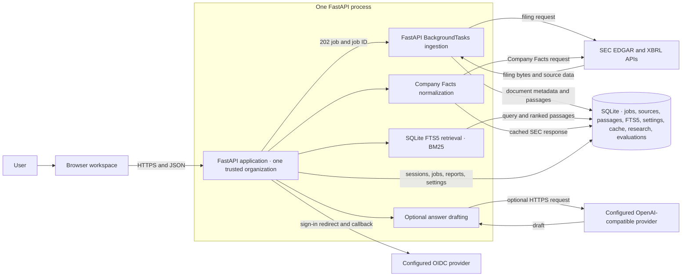

# Architecture

## Data ownership and flow

- SEC requests use only fixed `sec.gov` and `data.sec.gov` hosts. A contact email is required in the User-Agent. Requests have connection/read timeouts, a shared per-process pace limit, bounded filing size, one-hour to daily response caching, and retries for 429, 5xx, timeout, and connection failures. Failed source fetches never create empty document records.
- Hosted mode requires verified OIDC identity, HTTPS, a fixed public origin, trusted hostnames, and an explicit email allowlist. It uses a short-lived signed session cookie and never retains provider tokens.
- Uploads accept PDF, HTML, and UTF-8 text, up to 15 MiB. Extension and PDF magic bytes are checked. HTML scripts and style blocks are discarded; browser output is escaped. Local uploads never trigger external URL requests.
- Extracted passages keep a stable hash-derived ID, source document ID, section heading, and page where available. Re-uploading identical bytes returns the existing document.
- FTS5 uses SQLite's Porter tokenizer to match common English word forms. Existing search indexes are rebuilt from stored passages on application startup when the tokenizer changes.
- SEC filing selection uses the accession number from the current Submissions API and records `reportDate` separately from `filingDate`. SEC fiscal-year labels are sourced from Company Facts; the Submissions API response is not assumed to provide `fy`.
- SQLite stores settings, SEC cache, source metadata, passages, FTS5 index, ingestion job states, saved research responses, and evaluation runs. It is the sole durable service dependency.
- Financial facts come from SEC Company Facts and map three commonly reported US-GAAP metrics. Values are kept as decimal strings and calculated with Python `Decimal`. Fiscal-year labels use SEC `fy` from the earliest filing for the exact period; later comparative filings may repeat that period under a newer filing year. The selected value can still come from the latest filing. Facts without SEC `fy` are skipped. An annual comparison needs USD units, 10-K periods, annual durations between 300 and 400 days, and a positive prior value; adjacent duration lengths can differ by at most seven days for growth.
- Research output contains retrieved excerpts, fact IDs, source accession/URL, reporting periods, missing data, freshness, and caveats. Deterministic backend functions calculate metrics; the model is instructed not to calculate them.
- Optional narrative generation is disabled by default. When enabled, only the question, retrieved excerpts, and relevant facts are sent to the configured HTTPS provider. Draft citations must refer to supplied IDs and numeric values must occur in cited evidence or verified facts. These checks are structural and do not establish semantic accuracy.

## Quality and operational checks

The standard isolated fixture runner records the dataset SHA-256, method, top K, Recall@5, MRR, nDCG@5, latency, and missed references. Its synthetic fixture is not a financial dataset. Opt-in live SEC tests exercise Target ingestion and seven retrieval queries, plus three-issuer annual revenue comparison and 13 retrieval questions split across Walmart/Costco development data and one Apple issuer holdout. BM25 is compared with simple token overlap. The live set checks source anchors and XBRL facts, but it does not constitute human-judged semantic relevance or answer accuracy; see the [evaluation dataset](../datasets/issuer-research-evaluation.json) and [README test notes](../README.md#verify-the-project).

The API includes liveness/readiness probes, request IDs, validation errors, safe response headers, same-origin checks for writes, database indexes, a unique source key, paginated document listing, and persisted job states. The cloud profile is a single-organization deployment on one application replica, with SQLite on a persistent volume. All OIDC-allowlisted users share one corpus. Run one Uvicorn worker.

## Deferred architecture

Before adding replicas or serving multiple organizations, migrate to PostgreSQL with tenant-scoped migrations and query filters, a durable external worker queue, distributed rate limiting, and workspace-level authorization. Qdrant hybrid search, embeddings, reranking, semantic verification of generated prose, OCR, OpenTelemetry, PDF reports, and a human-reviewed answer-quality benchmark are also not implemented. The small live SEC retrieval set establishes only the measured behaviors and issuer coverage described above; it does not establish general research answer quality.
